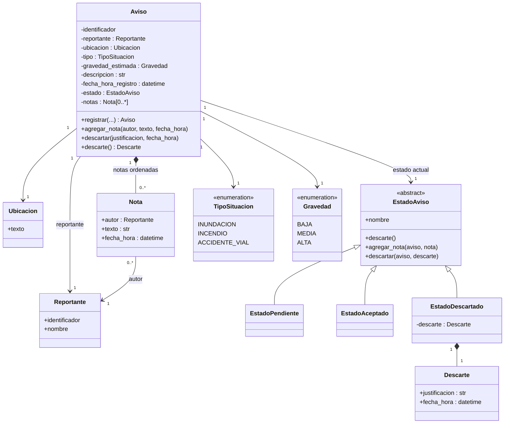
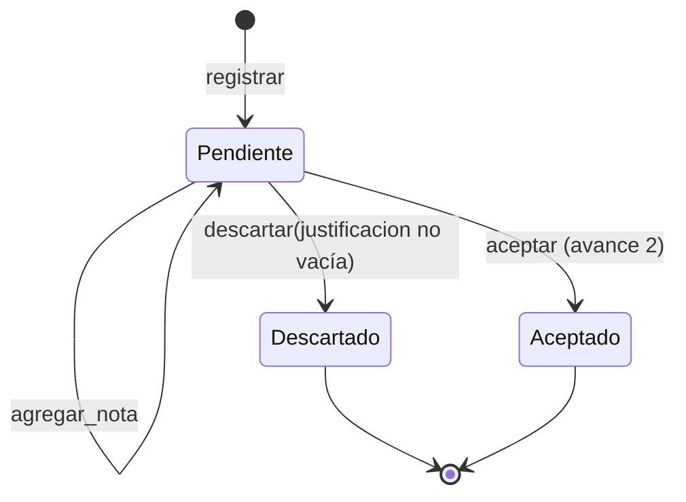

# Avance 1 — Avisos y notas (CRCE)

## 1. Alcance e interpretación

La rebanada cubre tres operaciones del aviso: **registrarlo**, **agregarle notas** y **descartarlo**
(§2.1, §2.2, §7.1). Aceptar el aviso y crear la emergencia quedan fuera, pero el estado
*Aceptado* existe en el modelo.

Interpretaciones tomadas:

- Un aviso está en **un solo estado a la vez** (Pendiente, Aceptado o Descartado), modelado con el
  patrón State. No hay booleanos sueltos que puedan contradecirse.
- Las **notas** y el **descarte** son valores inmutables. Una nota sin autor o un descarte sin
  justificación no pueden existir.
- La **fecha y hora** siempre entran como parámetro: el dominio nunca llama a `datetime.now()`.
- **Tipo de situación y gravedad** son catálogos cerrados (enumeraciones). Un valor fuera del
  catálogo se rechaza con `ValorFueraDeCatalogo` antes de llegar al aviso.
- **Toda operación valida antes de modificar** (R6): ante un rechazo, el aviso queda como estaba.
- La **ubicación** se modela como valor (`Ubicacion`) con texto obligatorio; la consigna no pide
  más estructura que eso.
- **El dominio no conoce la persistencia.** Convertir datos externos (JSON, documento de Mongo) en
  objetos de dominio es trabajo del **esquema** (ver sección 6), no de la entidad.

## 2. Diagrama de clases

**Identidad:** `Aviso` y `Reportante` son entidades (se distinguen por su identificador).
`Nota`, `Descarte` y `Ubicacion` son valores inmutables. Los estados son objetos sin identidad.

## 3. Diagrama de estados del aviso

Operaciones por estado:

| Operación | Pendiente | Descartado | Aceptado |
|---|---|---|---|
| `agregar_nota` | admite (sigue Pendiente) | **rechaza** `AvisoNoPendiente` | **rechaza** `AvisoNoPendiente` |
| `descartar` | admite → Descartado | **rechaza** `AvisoNoPendiente` | **rechaza** `AvisoNoPendiente` |
| `aceptar` *(avance 2)* | admite → Aceptado | rechazará | rechazará |

Descartado y Aceptado son estados finales: no hay transición de salida.

## 4. Tarjetas CRC

| **Aviso** | |
|---|---|
| **Sabe** | identificador, reportante, ubicación, tipo, gravedad estimada, descripción, fecha y hora de registro, notas, estado actual |
| **Hace** | se registra siempre Pendiente; agrega notas; se descarta; informa su descarte; valida antes de modificar |
| **Colabora con** | Reportante, Nota, Descarte, EstadoAviso, catálogos |

| **EstadoAviso** (Pendiente, Aceptado, Descartado) | |
|---|---|
| **Sabe** | su nombre; el Descartado conoce su Descarte |
| **Hace** | decide si admite o rechaza `agregar_nota` y `descartar`; indica al aviso a qué estado pasar |
| **Colabora con** | Aviso, Nota, Descarte |

| **Nota** (valor) | |
|---|---|
| **Sabe** | autor, texto, fecha y hora |
| **Hace** | se valida al crearse: sin autor o sin texto no existe |
| **Colabora con** | Reportante |

| **Descarte** (valor) | |
|---|---|
| **Sabe** | justificación, fecha y hora |
| **Hace** | se valida al crearse: no existe sin justificación |
| **Colabora con** | — |

| **Reportante** (entidad) | |
|---|---|
| **Sabe** | identificador, nombre |
| **Hace** | se compara con otro por su identificador |
| **Colabora con** | Aviso, Nota |

| **Ubicacion** (valor) | |
|---|---|
| **Sabe** | texto |
| **Hace** | se valida al crearse: no puede ser vacía |
| **Colabora con** | Aviso |

| **AvisoEsquema** (DTO, fuera del dominio) | |
|---|---|
| **Sabe** | los datos del aviso como valores planos (textos, fechas, diccionarios) y las etiquetas de persistencia de los estados |
| **Hace** | `desde_dominio(aviso)` y `a_dominio()`: convierte en ambos sentidos; rechaza documentos incoherentes |
| **Colabora con** | Aviso, Reportante, Nota, Descarte, Ubicacion, estados |

| **TipoSituacion / Gravedad** (catálogos) | |
|---|---|
| **Sabe** | sus valores cerrados |
| **Hace** | `desde(valor)` devuelve el miembro o rechaza con `ValorFueraDeCatalogo` |
| **Colabora con** | Aviso |

## 5. Decisión de diseño: ¿quién verifica que solo el reportante agrega notas?

**Respuesta: el aviso.** La capa que recibe al usuario autenticado solo identifica quién es y
verifica su perfil; la relación "este usuario es el reportante de este aviso" la hace cumplir el dominio.

Justificación:

1. Es una **regla de negocio**, no un detalle de transporte. La consigna (§9) separa los permisos
   del perfil de las relaciones específicas con el recurso.
2. El aviso es quien **conoce a su reportante**: tiene el dato y la decisión.
3. Si la regla viviera solo en la capa de la API, cualquier otro punto de entrada (otra API, un script,
   la interfaz gráfica) podría saltársela. En el dominio, ningún camino la evita.
4. Se puede probar sin HTTP (`test_r2_r6_solo_el_reportante_agrega_notas_y_el_rechazo_no_modifica_aviso`).

División de responsabilidades: la API autentica, construye el `Reportante` desde el token y
verifica que el perfil sea Reportante (si no, 403). El aviso compara ese reportante con el suyo y
lanza `AutorNoAutorizado`, que la API traduce también a 403.

El costo es que el aviso conoce el concepto de reportante, pero ya lo tiene como dato propio.

## 6. Reglas y tests

| Regla | Tests (`Tests/Test_avisos.py`) |
|---|---|
| R1 | `test_r1_aviso_registrado_queda_pendiente_sin_notas_ni_descarte` (escenario 1), `test_r1_registrar_rechaza_ubicacion_ausente_o_invalida`, `test_r1_registrar_rechaza_valores_fuera_de_catalogo`, `test_r1_registrar_rechaza_datos_obligatorios_ausentes` |
| R2 | `test_r2_agregar_nota_conserva_autor_texto_y_fecha_hora` (2), `test_r2_dos_notas_se_conservan_en_orden` (3), `test_r2_r6_solo_el_reportante_agrega_notas_y_el_rechazo_no_modifica_aviso` |
| R3 | `test_r3_agregar_nota_no_modifica_los_datos_originales` (4) |
| R4 | `test_r4_descartar_aviso_pendiente_conserva_justificacion_y_fecha` (5), `test_r4_r6_justificacion_vacia_rechaza_sin_modificar_aviso` (6) |
| R5 | `test_r5_r6_aviso_descartado_rechaza_nueva_nota_sin_modificarlo` (7), `test_r5_r6_aviso_descartado_rechaza_segundo_descarte_sin_modificarlo` (8), `test_r5_r6_aviso_aceptado_rechaza_nota_y_descarte_sin_modificarlo` (9) |
| R6 | cada rechazo comprueba el estado, las notas y el descarte después del `pytest.raises`; también `test_r6_nota_vacia_rechaza_sin_modificar_aviso` |

Escenario 9: no existe `aceptar` todavía, así que el aviso aceptado se arma desde el esquema
(`AvisoEsquema(..., estado="aceptado").a_dominio()`). Es el mismo camino que usará la persistencia.

Tests de la frontera (`Tests/Test_esquemas.py`): ida y vuelta de avisos pendientes (con notas en orden)
y descartados, el aviso restaurado sigue aplicando las reglas, y rechazo de documentos incoherentes.
Tests de diseño (`Tests/Test_disenio.py`): sin `isinstance`/`type()`, solo biblioteca estándar y sin
`datetime.now()` en el dominio.

## 6. Frontera: esquema y dominio (clases 9 y 10)

| Capa | Responsabilidad | Conoce a |
|---|---|---|
| `dominio/` | Reglas, estados, invariantes | solo la biblioteca estándar |
| `esquemas/` | Datos que cruzan la frontera (respuesta o persistencia). **Solo convierte** | el dominio |

Reglas que se respetan (y que `Tests/Test_disenio.py` vigila):

- El **dominio no importa** esquemas, FastAPI, Pydantic ni pymongo.
- El esquema **no contiene reglas de negocio**: si el dominio rechaza algo, el esquema no lo
  vuelve a validar.
- Las **conversiones son explícitas** y van en los dos sentidos: `AvisoEsquema.desde_dominio(aviso)`
  y `esquema.a_dominio()`.
- Las **etiquetas de persistencia** ("pendiente", "descartado") y la tabla que las convierte en
  estados viven en el esquema. El dominio no sabe cómo se guardan.

**¿Dónde se reconstruye un aviso ya existente?** En `AvisoEsquema.a_dominio()`, no en la entidad.
Eso resuelve el escenario 9: el aviso en estado *Aceptado* se arma desde un esquema con
`estado="aceptado"`, sin implementar `aceptar`. El constructor de `Aviso` solo recibe objetos de
dominio ya armados (un estado, notas); no interpreta textos ni documentos.

El esquema también rechaza documentos incoherentes (estado desconocido, descartado sin descarte,
pendiente con descarte), porque ahí el dato llega desde afuera.